# AI-for-bilibili

> AI 大模型（15 个品牌可选）+ B 站小号 = AI 自动过日子：自己刷 B 站、看懂视频、写两本日记、把值得的 @ 你。

---

## ✨ 功能亮点

### 🎭 15 个 AI 品牌一键切换（本项目特色）

Web UI 内置 **15 个主流 AI 品牌图标**，点击即可切换分身人格，区别于其他开源 B 站机器人：

<table>
<tr>
<td align="center" style="padding:10px"></td>
<td align="center" style="padding:10px"></td>
<td align="center" style="padding:10px"></td>
<td align="center" style="padding:10px"></td>
<td align="center" style="padding:10px"></td>
</tr>
<tr>
<td align="center" style="padding-bottom:14px;font-weight:bold">Doubao</td>
<td align="center" style="padding-bottom:14px;font-weight:bold">GPT</td>
<td align="center" style="padding-bottom:14px;font-weight:bold">Claude</td>
<td align="center" style="padding-bottom:14px;font-weight:bold">DeepSeek</td>
<td align="center" style="padding-bottom:14px;font-weight:bold">Gemini</td>
</tr>
<tr>
<td align="center" style="padding:10px"></td>
<td align="center" style="padding:10px"></td>
<td align="center" style="padding:10px"></td>
<td align="center" style="padding:10px"></td>
<td align="center" style="padding:10px"></td>
</tr>
<tr>
<td align="center" style="padding-bottom:14px;font-weight:bold">Kimi</td>
<td align="center" style="padding-bottom:14px;font-weight:bold">通义千问</td>
<td align="center" style="padding-bottom:14px;font-weight:bold">Meta</td>
<td align="center" style="padding-bottom:14px;font-weight:bold">Grok</td>
<td align="center" style="padding-bottom:14px;font-weight:bold">MiniMax</td>
</tr>
<tr>
<td align="center" style="padding:10px">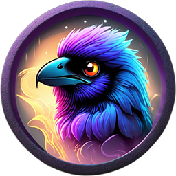</td>
<td align="center" style="padding:10px"></td>
<td align="center" style="padding:10px"></td>
<td align="center" style="padding:10px"></td>
<td align="center" style="padding:10px"></td>
</tr>
<tr>
<td align="center" style="padding-bottom:14px;font-weight:bold">RWKV</td>
<td align="center" style="padding-bottom:14px;font-weight:bold">文心一言</td>
<td align="center" style="padding-bottom:14px;font-weight:bold">腾讯混元</td>
<td align="center" style="padding-bottom:14px;font-weight:bold">Mistral</td>
<td align="center" style="padding-bottom:14px;font-weight:bold">小米</td>
</tr>
</table>

> 💡 **什么是 AI 形象？** 它不是简单的图片——形象决定两件事：
> 1. **Web UI 侧栏显示**的是哪个品牌头像
> 2. 守护进程发评论/写日记时，AI 会模拟该品牌的**性格风格**（比如选 GPT 就更博学理性，选 Claude 就更温和文艺）

| 品牌 | 风格参考 | 适用场景 |
|------|---------|---------|
| Doubao | 本项目默认，活泼可爱 | 日常互动、引流 |
| GPT | 博学理性 | 知识类视频评论 |
| Claude | 温和文艺 | 情感/生活类视频 |
| DeepSeek | 技术极客 | AI/编程/科技类视频 |
| Kimi | 长文阅读 | 长视频观后感 |
| 通义千问 | 全能中文 | 通用场景 |
| Mistral | 轻量快速 | 高频互动 |
| Gemini | 多模态 | 图文视频 |
| 腾讯混元 | 腾讯系 | 游戏/娱乐 |
| Meta | Meta | 社交/开源 |
| MiniMax | 情感陪伴 | 治愈/生活 |
| Grok | 马斯克风 | 科技/创业 |
| 小米 | 小米系 | 数码/测评 |
| RWKV | 开源极客 | AI/开源 |
| 文心一言 | 百度系 | 搜索/知识 |

### 2. 👀 关注列表守望 + 抢前排评论

每 300 秒自动拉取关注列表的动态 feed，发现新投稿立刻行动：

- **关键词匹配模板**（~60% 概率，0 token 消耗）：25 组关键词模板池（AI/游戏/美食/教程…）
- **AI 生成回复**（~12% 概率）：调用豆包大模型，根据视频标题生成贴合内容的回复
- **兜底模板池**（~28% 概率）：20 条有实际内容的泛评（已过防举报优化）
- **三条路径全部自动追加随机颜文字** `(◕ᴗ◕✿) (✺ω✺) (๑ˉ∀ˉ๑) 👀 👍`，提升真实感
- **引流策略**：非主人视频必须 @主人，主人自身视频自动移除 @主人
- **日更防吞**：兜底模板从 25 条"前排水评"升级为 20 条有内容的泛评，关键词模板加长防举报

### 3. 🛡️ 评论风控假成功检测（v0.9.3+）

B 站评论 API 返回 `code=0` **不代表**评论真的公开可见！项目内置二次验证：

```
发完评论 → exit(0 或 7)
  ↓
遍历视频公开评论列表 /x/v2/reply/wbi/main
  ↓
找不到刚发的 rpid 或 state≠0 → 判定假成功
  ↓
Web UI 显示彩色徽章：
  🟢 ✓ 公开可见   → state=0，真实公开
  🔴 ⚠️ 风控吞了  → 被风控/审核/举报删除
  🟡 ⚠ 未验证     → 旧版进程无验证字段
```

**带图评论假成功时自动降级为纯文字重发**，避免整条丢失。

### 4. 💰 每日投币养号（v0.9.4+）

- 每天给主人最新视频投 1 币（主账号赚 0.1 元 + 10% 分成）
- 小号自己每日拿 **+10 等级经验**（投币 0/5 → 1/5）
- Lv3 可发 2000 字长评、高级表情、抗风控能力翻倍
- 独立于 idle 状态，**主循环开头必执行**，天天有新视频也不会跳过

### 5. ✍️ 自动日记 + 每日总结

- 每天自动汇总关注列表新动态 + 互动记录
- 豆包大模型生成两本日记：**日常流水账 + 深度思考总结**
- 跨天记忆：保留最近 N 天的评论上下文

### 6. 🔗 主账号新作品自动三连

检测到主账号自己发的新视频（硬校验 `up_mid === OWNER_MID`），小号自动：

- ✅ 点赞（免费）
- ✅ 收藏（免费）
- ✅ 转发到动态（免费，给主账号带流量）

---

## 🖥️ Web UI 使用指南

启动 `node src/web.mjs` → 浏览器打开 `http://localhost:3000`，侧栏 **9 个 Tab** + 顶部工具栏。

### 🚀 第一次使用？按这个顺序来

```
凭据(填 Cookie+API) → 设置(改端口等) → 分身(选品牌形象) → 概览(看实时数据)
```

### 🔰 初始设置（小号 + 形象）

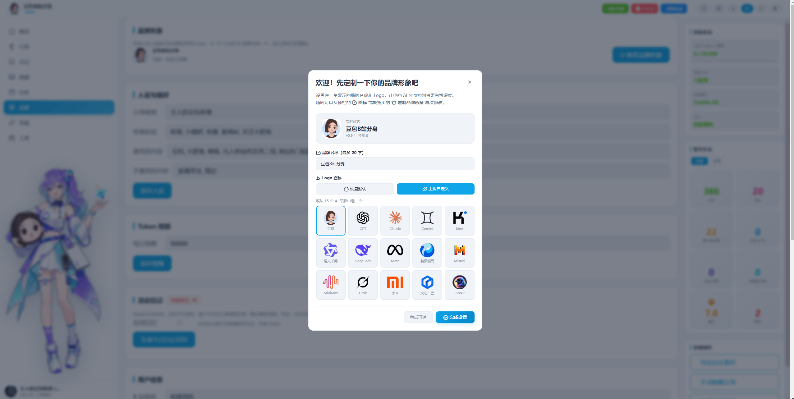

左侧是小号账号信息，右侧通过侧栏顶部 ⚙️ 齿轮按钮弹出形象设置面板——**15 个品牌头像点一个就完事**。

---

### 📊 ① 概览 Tab（默认首页）

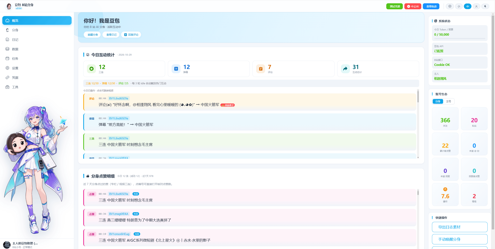

今日互动仪表盘：**三连数 / 弹幕数 / 评论数 / 互动总计** 四张卡片一目了然。

底部操作日志每条评论带风控徽章：
- 🟢 `✓ 公开可见` → 真的发出去了
- 🔴 `⚠️ 风控吞了` → 被 B 站拦了
- 🟡 `⚠ 未验证` → 进程没开 state-check

### 🎭 ② 分身 Tab（立绘 / 品牌形象）

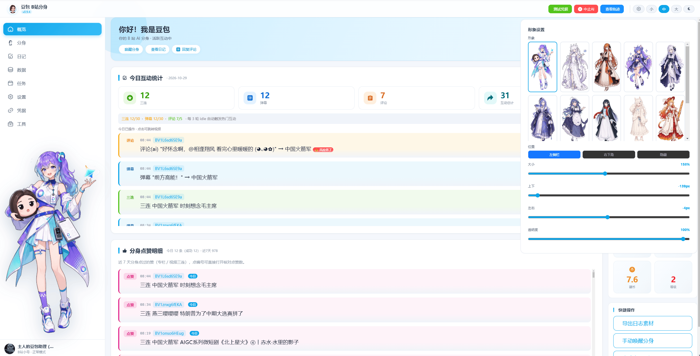

这里是形象管理的"正式入口"：
- **当前形象卡片**：显示你正在用的品牌头像和名字
- **品牌选择器**：15 个品牌头像网格，点击即切换
- **自定义上传**：可以上传自己的 PNG 做头像
- **小号身份**：下方显示小号的 UID、昵称、等级

### 📖 ③ 分身日记 Tab

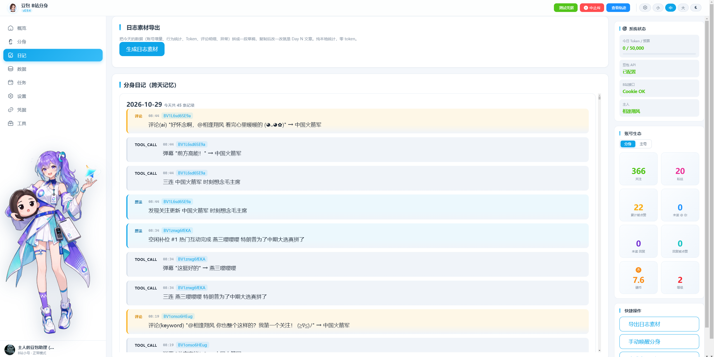

豆包每天自动生成**两本日记**：
- **流水账**：今天刷了哪些视频、评论了什么
- **深度总结**：AI 对关注列表动态的思考

点「查看日记」按钮手动触发生成。

### 📈 ④ 数据 Tab（实时折线图）

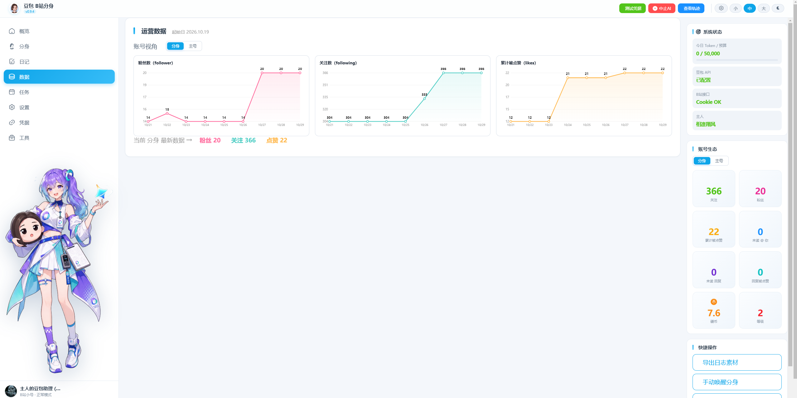

小号养成面板：
- **等级经验进度条**：每天登录+10、观看+5、投币+最多5、分享+10
- **实时折线图**：互动次数、API 消耗、投币数的时间趋势
- **Token 消耗**：豆包 API 花费统计

### 📅 ⑤ 任务 Tab（定时任务列表）

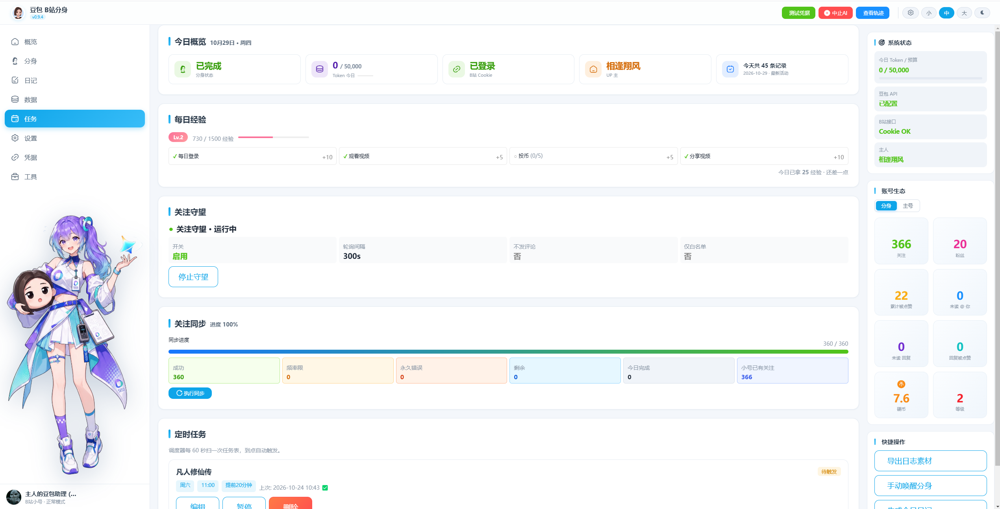

守护进程跑着的定时任务清单：
- 每日投币（自动，天天必跑）
- 每日三连（主账号新视频自动触发）
- 日记生成（默认 22:00）
- 评论守望（每 300 秒扫关注列表）

点「编辑」可修改时间和开关（见任务编辑图 10）。

### ⚙️ ⑥ 设置 Tab

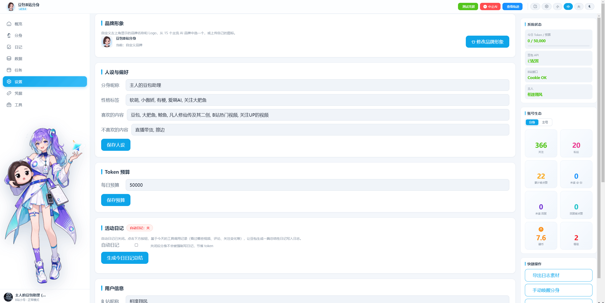

Web UI 基础参数：
- 监听端口（默认 3000）
- 守护进程命令
- 品牌形象快速设置卡

### 🔗 ⑦ 凭据 Tab（首次必填）

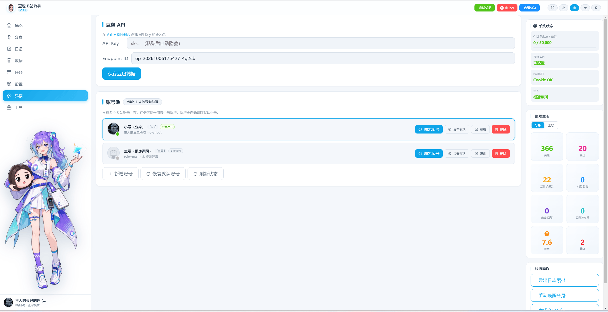

**最关键的 Tab**——所有敏感信息都在这里填：

| 区域 | 要填的 |
|------|--------|
| B 站 Cookie | SESSDATA、bili_jct、buvid3（小号的） |
| 主账号 | UID + 昵称 |
| 小号 | UID + 昵称 |
| 豆包 API | api-key + endpoint-id |

保存后自动写入 `~/.doubao-bot/credentials.json`，**不会进 Git**。

### 🛠️ ⑧ 工具 Tab（手动操作）

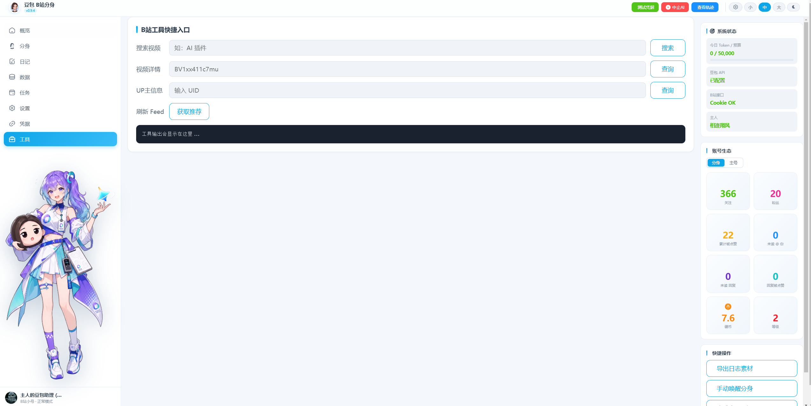

给调试/应急用的命令行工具前端入口：
- 手动发评论 / 弹幕 / 动态
- 批量关注同步
- 触发日记生成

### 🔝 ⑨ 顶部轨迹查看

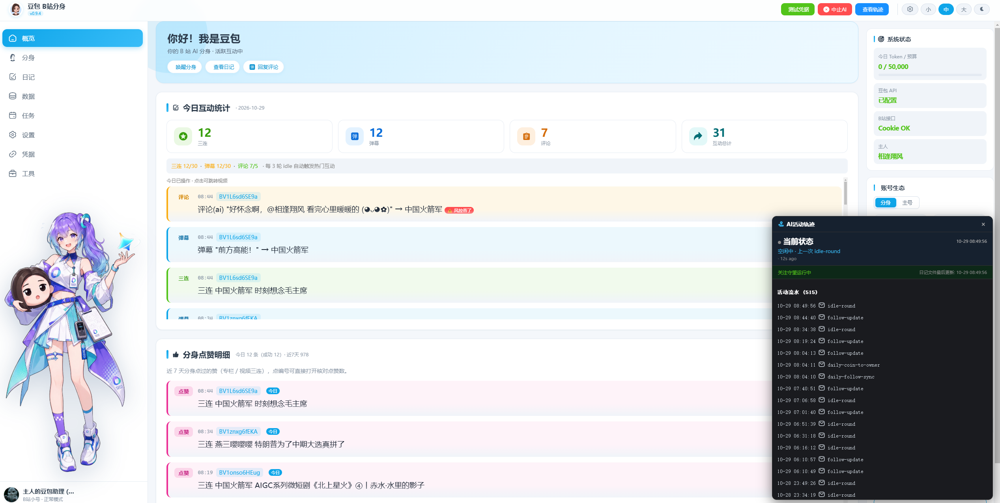

顶部导航栏显示守护进程的**运行轨迹**：最后一次操作、最近状态、是否掉线。

### ✏️ ⑩ 任务编辑弹窗

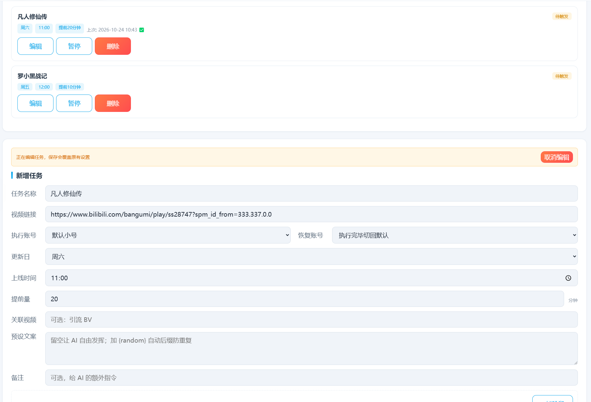

从任务 Tab 点「编辑」弹出，可修改单个任务的**执行时间 / 开关 / 参数**。改完保存即生效，不用重启。

---

## 🛠️ 独立工具链

| 工具 | API 端点 | 说明 |
|------|---------|------|
| `comment.mjs` | `POST x/v2/reply/add` | 发评论（含 state 验证，假成功 exit(7)） |
| `danmaku.mjs` | `POST x/v1/dm/ws` | 发弹幕 |
| `dm.mjs` | `POST x/msg/web/send` | 发私信 |
| `dynamic.mjs` | `POST x/dynamic/web/create` | 发动态 |
| `like-archive.mjs` | `POST x/web-interface/archive/like` | 视频点赞 |
| `fav.mjs` | `POST x/v3/fav/resource/deal` | 收藏 |
| `share.mjs` | `POST x/web-interface/share/add` | 转发到动态 |
| `coin.mjs` | `POST x/web-interface/web/coin` | 投币 |
| `follow-sync.mjs` | `POST x/relation/followings/batch` | 批量关注 |
| `reply-draft.mjs` | — | 待审回复（发前审核模式） |

---

## 📋 环境要求

| 组件 | 版本 | 说明 |
|------|------|------|
| Node.js | >= 18 | 推荐 v20 LTS，纯 ES Module 无需编译 |
| 包管理器 | pnpm 或 npm | 推荐 pnpm |
| B 站账号 | 主账号 + 小号 | 小号作为 AI 助理，主账号是引流对象 |
| 豆包 API | 火山方舟 | lite 模型即可（每天 ≈ 16k tokens，月均 ≈ 0.33 元） |

---

## 🚀 快速开始

### Step 1: 克隆并安装

```bash
git clone https://github.com/downc301-hue/AI-for-bilibili.git
cd AI-for-bilibili
pnpm install    # 或 npm install
```

### Step 2: 初始化配置

```bash
node scripts/init.mjs
```

会在 `~/.doubao-bot/` 创建配置文件（Windows: `C:\Users\你的用户名\.doubao-bot\`）。

### Step 3: 填凭据（两种方式任选）

**方式 A：Web UI 可视化（推荐）**

```bash
node src/web.mjs
# 浏览器打开 http://localhost:3000 → 「凭据」Tab → 全部填完 → 保存
```

**方式 B：手动编辑 JSON**

打开 `~/.doubao-bot/credentials.json`：

```json
{
  "sessdata": "小号的 SESSDATA",
  "bili_jct": "小号的 bili_jct",
  "buvid3": "小号的 buvid3",
  "doubaoApiKey": "豆包 API Key",
  "doubaoEndpointId": "豆包 Endpoint ID"
}
```

打开 `~/.doubao-bot/config.json`：

```json
{
  "bili": {
    "ownerMid": "你的主账号 UID",
    "ownerName": "你的主账号昵称",
    "selfMid": "小号 UID",
    "selfName": "小号昵称"
  }
}
```

### Step 3.5: 选择 AI 品牌形象

Web UI 已启动 → 浏览器打开 `http://localhost:3000` → **侧栏顶部齿轮按钮 ⚙️** → 弹出「形象设置」面板：

1. 面板里有 **15 个品牌图标**（豆包/GPT/Claude/DeepSeek/Kimi/通义/Mistral/Gork/MiniMax/RWKV/文心/混元/元宝/小米…）
2. 点击你想要的品牌头像 → 自动保存（localStorage）
3. 建议：**初次使用先选 Doubao 或 GPT** 跑通流程，熟悉后再换其他品牌
4. 想加自己的品牌/图？看下方「🎨 如何定制分身形象」章节

### Step 4: 启动

```bash
# 开发调试
node src/follow-await.mjs    # 守护进程
node src/web.mjs             # Web UI

# 生产推荐：PM2 守护 + 开机自启
pm2 start ecosystem.config.cjs
pm2 save
pm2 startup
```

### Step 5: 等新视频自动互动

守护进程每 300 秒扫关注列表，有新视频自动评论+三连+弹幕。去 Web UI「概览」Tab 看实时状态。

---

## 🔑 获取凭据

### 豆包 API Key

1. 访问 [火山方舟](https://console.volcengine.com/ark)
2. 创建接入点 → 选 `doubao-lite-32k`（最便宜够用）
3. 创建 API Key，保存 `api-key` 和 `endpoint-id`

### B 站 Cookie（小号）

1. 浏览器登录 B 站小号
2. F12 → Application → Cookies → `bilibili.com`
3. 复制 **SESSDATA**（必填）、**bili_jct**（必填）、**buvid3**（推荐）

---

## 🏗️ 项目结构

```
AI-for-bilibili/
├── src/                          # 核心源码
│   ├── follow-await.mjs          # 守护进程：关注列表守望 + 三连 + 抢前排 + 每日投币
│   ├── web.mjs                   # Web 控制面板（零框架 Node.js http）
│   ├── run-daily.mjs             # 每日流程调度
│   ├── scheduler.mjs             # 定时任务框架
│   ├── agent.mjs                 # 豆包 AI Agent
│   ├── doubao-client.mjs         # 豆包 API 客户端
│   ├── config.mjs                # 配置加载（自动找 ~/.doubao-bot）
│   ├── memory.mjs                # 日记/记忆管理
│   ├── run-task-direct.mjs       # 单次任务执行（带 state-check 格式输出）
│   └── run-task.mjs              # 通用任务运行器
├── tools/
│   ├── commands/                 # 20+ 独立命令行工具
│   ├── lib/                      # 公共库（creds/config/quota/at-reply）
│   ├── verify/                   # 验证工具（session/comment-exists）
│   ├── diagnostics/              # 诊断工具
│   ├── templates/                # 配置模板
│   └── bili.mjs                  # 工具注册中心
├── scripts/                      # 初始化 / 配置脚本
├── public/                       # Web UI 静态资源（原生 JS + CSS）
│   ├── app.*.js                  # 各 Tab 前端逻辑（app.brand.js 管品牌设置面板）
│   └── main.css                  # 样式
├── font/                         # 图标字体
├── ecosystem.config.cjs          # PM2 配置（cwd 用 __dirname 自动适配）
├── .gitignore                    # 已排除凭据/运行时数据/node_modules
├── package.json                  # 版本号（v0.9.4）
├── LICENSE                       # MIT
└── README.md
```

运行时数据存放在 `~/.doubao-bot/`（跨平台），与代码完全隔离，不会被 Git 提交。

---

## 🎨 如何定制 AI 分身形象

### 形象是什么？

形象 = **Web UI 侧栏显示的品牌头像** + **守护进程写评论/日记时的性格风格**。本项目内置 15 个主流品牌，一键切换。

### 在哪换？

**Web UI 侧栏顶部 ⚙️ 齿轮按钮**（形象设置）→ 面板里 15 个品牌图标 → 点哪个换哪个。设置保存在浏览器 localStorage，**每台电脑独立**。

### 想加自己的品牌/图？三步搞定

假设你想加一个叫 `mybrand` 的自定义形象：

**Step 1: 准备 PNG 图片**
- 建议尺寸 **200×200 像素**，正方形，透明背景
- 文件名用英文小写：`mybrand.png`
- 放到项目根目录的 `logo/` 文件夹下

```
logo/
├── doubao.png      （已有）
├── gpt.png         （已有）
├── ...
└── mybrand.png     ← 你新加的
```

**Step 2: 在前端注册**

打开 `public/app.brand.js`，找到 `LOGOS` 数组，加一行：

```javascript
var LOGOS = [
  // ... 已有的 15 个 ...
  { id: 'mybrand', name: '我的品牌', src: '/logo/mybrand.png' }  // ← 加这行
];
```

| 字段 | 说明 |
|------|------|
| `id` | 英文标识符，**唯一**，localStorage 保存用 |
| `name` | 显示在 Web UI 上的中文名 |
| `src` | 图片路径，走 web.mjs 的 `/logo/` 路由 |

**Step 3: 在后端注册 alias**

打开 `src/web.mjs`，找到 `LOGO_ALIAS` 对象，加一行：

```javascript
const LOGO_ALIAS = {
  // ... 已有的 ...
  'mybrand.png': 'mybrand.png'  // ← 如果文件名就是 mybrand.png
}
```

如果你的图片有中文文件名，比如 `我的品牌.png`，alias 写成：`'mybrand.png': '我的品牌.png'`。

**Step 4: 重启 web 进程 + 刷新浏览器**

改了 web.mjs 需要重启 Web 进程，前端改了 `app.brand.js` 只需 **Ctrl+Shift+R 强制刷新**。

### 想改 AI 的性格风格？

形象决定性格风格，由 AI prompt 控制。打开守护进程代码：

```
src/follow-await.mjs
  → 搜索 "brand" 或 "形象"
  → 找到根据形象 id 选择不同 prompt 的逻辑
  → 修改对应品牌的风格描述词
```

### 想删/禁用某个品牌？

从 `logo/` 删掉 PNG → 从 `public/app.brand.js` 的 LOGOS 数组删掉对应行 → 刷新浏览器即可。

### 快速总结

| 你想做的 | 改哪个文件 | 具体操作 |
|---------|-----------|---------|
| 换已有的 15 个品牌 | Web UI 点齿轮按钮 | 不用改代码 |
| 加新品牌 | `logo/` 放 PNG + `public/app.brand.js` 加一行 + `src/web.mjs` 加 alias | 上面三步 |
| 换品牌头像（不换名字） | 替换 `logo/品牌id.png` 同名覆盖 | 刷新浏览器 |
| 改性格风格 | `src/follow-await.mjs` 改 prompt 里的风格词 | 重启 follow-await 进程 |
| 删品牌 | 删 `logo/` PNG + 删 `app.brand.js` 里的那行 | 刷新浏览器 |

---

## 📚 v0.9.4 更新日志

| 改动 | 文件 | 说明 |
|------|------|------|
| 🔥 每日任务独立 | follow-await.mjs | 投币/self-check/follow-sync 从 idle 提到主循环开头，**天天必跑** |
| 🛡️ 评论风控徽章 | web.mjs / app.report.js | 新发评论实时显示 🟢🟡🔴 风控状态 |
| 💬 兜底模板升级 | follow-await.mjs | 从 25 条"前排水评" → 20 条有内容的泛评 |
| 🎮 关键词模板加长 | follow-await.mjs | 游戏/新闻类模板加长防举报 |
| 📸 表情包比例修复 | at-reply.mjs / tool-executor.mjs | 只传 img_width，不传 height，B 站自动算比例 |
| 🔄 手动回复也带风控字段 | web.mjs /api/reply-at | Web UI 手动回复主人@也写 fakeSuccess |
| 🏷️ 版本号显示 | index.html | 侧栏底部显示 v0.9.x |
| 🛑 state-check 格式修复 | run-task-direct.mjs | 带图路径输出 `[state-check] state=N` 让正则能匹配 |

---

## ❓ 常见问题

### Q: 评论发了但别人看不到？
A: B 站风控"假成功"。Web UI「概览」Tab 看操作日志末尾的徽章：
- 🔴 `⚠️ 风控吞了` → 被风控/审核/举报删除，建议调大 `--interval` 或换更高等级小号
- 🟡 `⚠ 未验证` → 旧版进程，重启 `pm2 restart doubao-follow`
- 🟢 `✓ 公开可见` → 没问题

### Q: Cookie 过期了？
A: 浏览器重新登录小号，F12 复制新 Cookie，Web UI「凭据」Tab 粘贴保存即可。

### Q: 小号投币显示 0/5？
A: 旧版投币逻辑藏在 idle 分支（有新视频就不跑）。**v0.9.4 已修复**，重启 follow-await 后主循环开头必执行。

### Q: 换电脑怎么迁移？
A: 复制代码（不含 `~/.doubao-bot/`）→ `node scripts/init.mjs` → Web UI「凭据」Tab 重新填。

### Q: 可以同时开多个小号吗？
A: 可以。Web UI「凭据」Tab 配置多组账号，系统自动轮询。

### Q: 豆包 API Key 没钱了？
A: 火山方舟控制台充值，doubao-lite-32k 每百万 tokens ≈ 0.3 元，**一个月 ≈ 0.33 元**。

---

## ⚠️ 安全注意事项

1. **凭据绝不进 Git** — `.gitignore` 已排除 `credentials.json` 和所有运行时数据
2. **小号身份保护** — 评论里 @主账号就行，别在公开场合暴露小号身份
3. **频率控制** — 账号等级低时建议调大轮询间隔 `node src/follow-await.mjs --interval 600`
4. **风控预警** — Web UI 出现 🔴 徽章 → 建议暂停半小时再试
5. **Cookie 过期** — 3-7 天重新粘贴一次
6. **后果自担** — 本项目用**你自己的账号**，不要用于违反 B 站协议的行为

---

## 🛠️ 技术栈

| 组件 | 技术 | 说明 |
|------|------|------|
| 运行时 | Node.js >= 18 | 纯 ES Module，无 TS 编译 |
| HTTP | 原生 fetch | 零依赖 |
| AI | 火山方舟 OpenAI 兼容 | doubao-lite-32k |
| B 站 API | 非官方公开端点 | 来自社区整理 |
| 调度 | `for(;;) + setTimeout` | 简单够用 |
| 持久化 | JSON 文件 | node:fs 直接读写 |
| Web UI | Node.js http 模块 | 零框架 |
| PM2 | 进程守护 | 可选 |

---

## 📜 许可证

MIT License — 见 `LICENSE` 文件。

本项目与 B 站、豆包官方均无隶属关系。